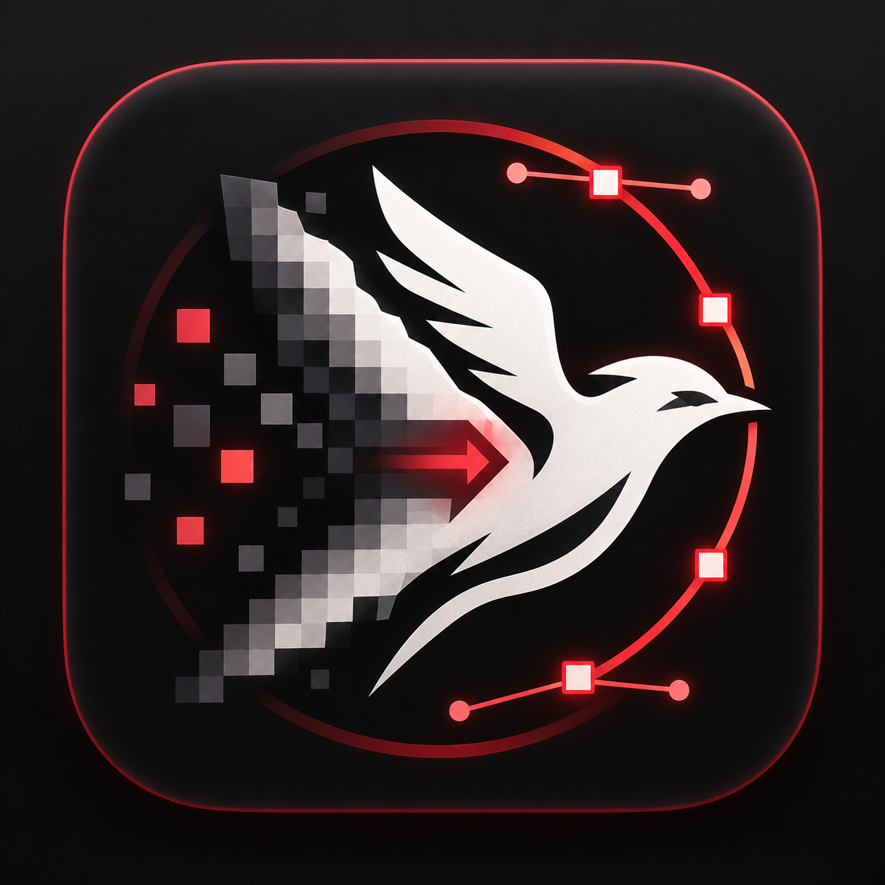
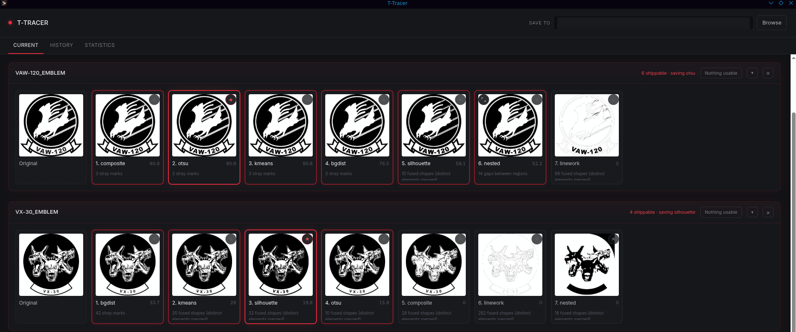
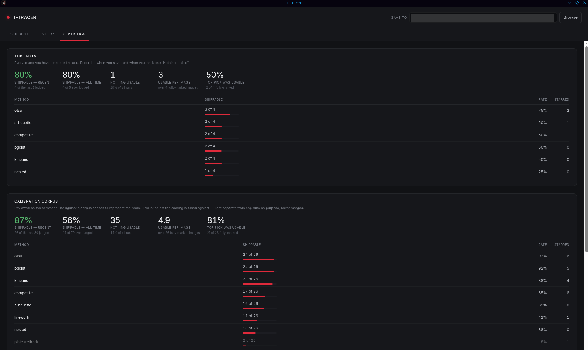

<div align="center">



# T-Tracer

**Turns a customer logo into a laser-ready SVG: drop images in, click the trace that looks right,
get clean closed-path vectors out, with no manual work in Illustrator.**

</div>

## Why it's worth it

- **Most logos come out shippable without hand-tracing.** Each image is traced six different
  ways (five strategies plus one on trial) and the results are scored and laid side by side.
  On real customer artwork, 26 of 28 logos (93%) had at least one shippable trace, 4.9 per logo
  on average.
- **You choose by looking, not by trusting a number.** The top-scored trace was shippable only
  81% of the time, so the app shows pictures: click the ones you'd send, star the keeper, open
  any candidate full size beside the original and step through with the arrow keys.
- **The output cuts cleanly.** Every shape is a closed path in one `<path>` with
  `fill-rule="evenodd"`, so holes stay holes; it is plain SVG that XCS, LightBurn or any
  vector tool opens.
- **A big batch won't freeze your machine.** `--jobs 0` sizes the worker pool from free memory
  and caps it at half your cores.
- **You see how well it is really doing.** The Statistics tab reports per-strategy reliability
  and how often nothing was usable, keeping your own runs and the calibration set apart.

## Is it for you?

**Fits when** you engrave or cut customer logos, patches or insignia (it was built for an xTool
F2 Ultra UV) and spend time cleaning up auto-traces or redrawing them.

**Skip it when** you need photo-style or greyscale engraving (it makes one-colour ink/no-ink
shapes; per-colour layers only through `--strategies kmeans-layered`), you trace a logo once
a year (Illustrator's Image Trace is enough), or you need a tested macOS app (see Status).

**Needs:** Windows, or Linux with Python 3. **Real cost:** free (MIT). The Windows installer
downloads Python and PyTorch if the machine lacks them: about 2 GB on first install, no admin
rights needed.

## Quick start

**Windows:** download `T-Tracer-Setup.exe` from [Releases](../../releases/latest) and run it.

**Linux / macOS:**

```bash
git clone https://github.com/JudgeBreddd/t-tracer.git
cd t-tracer/app
./install.sh
./T-Tracer
```

**It worked if** a T-Tracer window opens; drag a logo in and a row of traced candidates appears.

## What it looks like

Every image is traced several ways and the results are laid out side by side. Click the ones
you would actually send to a customer, star the one to keep.



Any candidate opens at full size beside the original, because judging whether a hairline
survived is a comparison, not a glance. Arrow keys move along the slate.

The Statistics tab reports what actually happened: per-strategy reliability and how often
nothing was usable. Your own runs and the calibration corpus are kept separate and never
averaged together.



## How it works, and why it is built this way

Most auto-tracers give you one answer. This one gives you several, from different strategies,
and asks you to choose.

That is not indecision. Tracing a logo for engraving has no single correct answer: the same
mid-luminance gold is *ink* on one crest and a *background field* on another, and no threshold
can tell those apart, because the difference is structural rather than tonal. So the tool runs
every strategy, scores each result, and puts them side by side.

Measured over three calibration batches on real customer artwork:

| | |
|---|---|
| logos with at least one shippable result | **93%** (26 of 28) |
| shippable candidates per logo, on average | **4.9** |
| top-ranked candidate was shippable | **81%** |

The score is good at finding the *neighbourhood* and unreliable at picking the winner, which is
exactly why the interface shows you pictures instead of a number.

### The strategies

| | |
|---|---|
| `otsu` | Global luminance threshold. The baseline, and still the most reliable single strategy. |
| `bgdist` | CIELAB distance from the detected background. Does not require the artwork to be darker than its surroundings. |
| `kmeans` | Colour clustering in CIELAB; the cluster that owns the border is background. |
| `composite` | `otsu` as the base, with a region-containment pass allowed to punch holes in large solid fields. Answers the "everything went black" failure. |
| `layerlines` | The colour split drawn as an engraving: every boundary between two colours becomes a black line, dark regions are filled. Built for multi-colour insignia; abstains on one-colour art. |
| `fieldflip` | On trial: flips a large field between ink and background when the artwork suggests it was read the wrong way round. |

Five, down from ten in September 2026, on the evidence of 95 judged images: two strategies
cover everything that was ever shippable and the other three are the ones the reviewer actually
starred. `--strategies` still reaches the rest (`silhouette`, `keyline`, `keyfill`, `keyflip`,
`linework`, `nested`, `kmeans-layered` (one `<path>` per colour, for recolouring), `plate`,
`neural`, `edges`, `sauvola`, `inotsu`, `triotsu`), each kept with its failure documented in
the source or in [method-index.md](method-index.md) so nobody rediscovers it.

### Deeper

**[HOW-IT-WORKS.md](HOW-IT-WORKS.md)** is the full technical tour: the mask → contour → Bézier
pipeline, how each strategy decides what is ink, the scoring metrics and how far to trust them,
the determinism fix, and why the worker count is sized by free memory rather than core count.

### Command line

The app is a front end. Everything is available directly:

```bash
.venv/bin/python _engine/candidates.py --in ./logos --out ./out
.venv/bin/python _engine/pick.py --dir ./out
```

`--jobs 0` sizes workers by free memory rather than core count, and caps at half the cores, so
a batch does not take the machine down with it.

App state (traced jobs, settings, picks) lives in `~/.cache/t-tracer/` (`%LOCALAPPDATA%` on
Windows); set `TT_WORK_DIR` to move it.

## Status and known gaps

Version 0.1.2. In use on daily orders on Linux.

- **The Windows installer has never been run on a real Windows machine.** It is built by a
  GitHub Actions Windows runner and attached to each release, but no clean install has been
  tested.
- **macOS is untested.** `install.sh` is written for Linux and may work on macOS; nobody has
  tried it.
- **The 93% figure is from three calibration batches (28 logos) in September 2026**, measured
  before the slate was trimmed from ten strategies to five. Later judging (41 images) found
  `otsu` + `bgdist` alone still give a shippable trace on 40 of 41.
- **About 1 logo in 14 still defeats every strategy.** The usual cause is deciding which
  mid-tone colours are ink, not the curve fitting. An optional **Fix interpretation** editor for
  those cases (palette choices, colour and region toggles) is built but still being judged on
  real orders.
- `fieldflip` is a trial and may be removed.

## Contributing

Bug reports and pull requests welcome: see [CONTRIBUTING.md](CONTRIBUTING.md).

The most useful bug report is **an image it fails on**, plus which strategy got closest and what
is wrong with it. Those are the interesting ones.

## Credits and licence

Built on [OpenCV](https://opencv.org/), [scikit-image](https://scikit-image.org/),
[NumPy](https://numpy.org/), [SciPy](https://scipy.org/), [Pillow](https://python-pillow.org/),
[svgelements](https://github.com/meerk40t/svgelements), [FastAPI](https://fastapi.tiangolo.com/)
and [pywebview](https://pywebview.flowrl.com/).

MIT: see [LICENSE](LICENSE).
